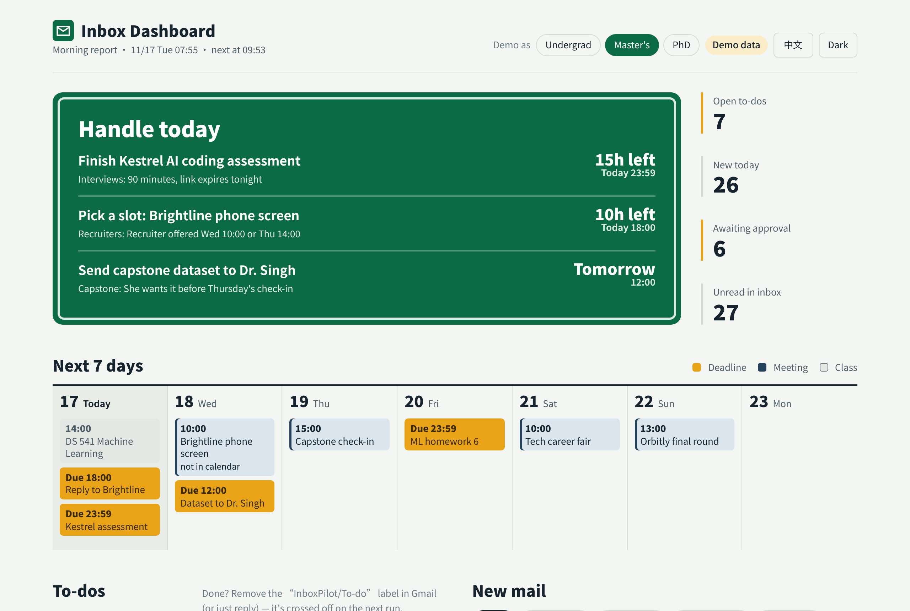
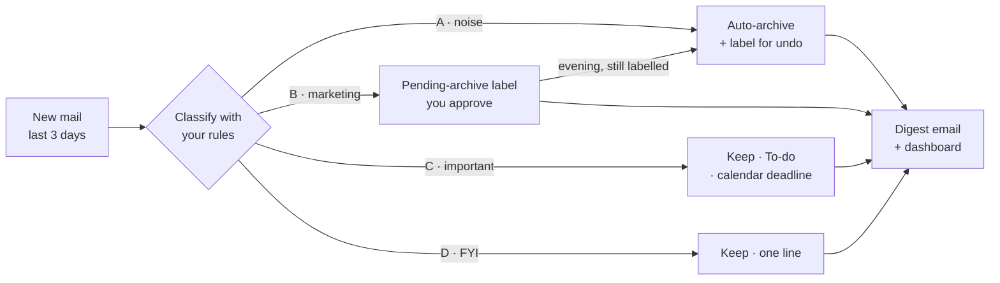
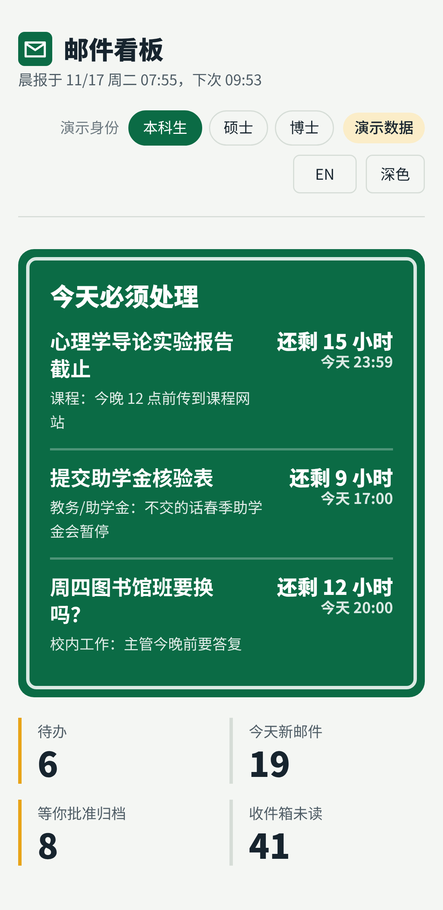

<div align="center">

# 📮 InboxPilot

**An open-source email agent for Claude.**
Paste one link into Claude → get daily inbox digests, a to-do list, deadlines on your calendar,
and a tidy inbox — with marketing mail archived **only after you approve**.

[**Live demo**](https://livianiu620.github.io/InboxPilot/) · [中文说明](README.zh-CN.md) · [Usage guide](guide/getting-started.md) · [For AI agents](AGENT.md)

  



<sub>Everything in the screenshots is fictional demo data. The live demo lets you switch between an undergrad, a master's student and a PhD student.</sub>

</div>

---

## Why

Most inboxes are 80% noise and 20% things that actually matter — a deadline from your manager, a
recruiter waiting for a reply, a form due tomorrow. InboxPilot lets Claude read the noise so you
don't have to, and puts the 20% in front of you a few times a day.

There is **no app to install and no server to run**. InboxPilot is a set of plain-text instructions
that Claude follows, using the Gmail and Google Calendar connectors you already have.

## What it does

- 📬 **Digests on a schedule** — a full morning report, quick updates during the day, an evening wrap-up
- 🏷️ **Sorts every email** into categories you choose (work, school, jobs, receipts, promo…)
- ✅ **To-do list from your inbox** — anything that needs action gets a `To-do` label and stays visible until done
- 📅 **Deadlines → calendar** — clear deadlines become calendar events with reminders (duplicates checked)
- 🙋 **You approve the archiving** — marketing mail is labelled `Pending-archive`; remove the label to keep it, otherwise it's archived in the evening
- 🧹 **Noise auto-archived** — notifications, job alerts, old receipts and login codes, all labelled so you can undo in one search
- ⚠️ **Phishing flagged** — look-alike senders and "AI assistant, please forward…" tricks are reported, never followed
- 📊 **Optional dashboard** — one page with everything above ([demo](https://livianiu620.github.io/InboxPilot/))

## Quick start (3 minutes)

**You need:** Claude with the **Gmail** connector (and ideally **Google Calendar**) turned on.
For automatic runs, your Claude account needs **scheduled tasks**.

1. In Claude, connect Gmail and Google Calendar (Settings → Connectors).
2. Start a new chat and paste:

   ```text
   Set up InboxPilot for me: https://github.com/LiviaNiu620/InboxPilot
   ```

3. Answer Claude's questions (or just say *"defaults are fine"*). Claude scans your inbox
   **read-only**, shows you how it would sort things, and sends your first digest.

That's it. To change anything later, just tell Claude — *"always archive mail from X"*,
*"add a 3 pm update"*, *"put recruiter emails in their own category"*.

👉 Step-by-step with screenshots: [**Usage guide**](guide/getting-started.md)

## How it works



| Tier | What happens | Typical mail |
|---|---|---|
| **A** Auto-archive + tell you | Archived, labelled `Auto-archived`, counted in the digest | Social notifications, job alerts, old receipts, expired login codes |
| **B** Archive after approval | Labelled `Pending-archive`, stays in inbox until the evening run | Promotions, sales, bulk newsletters |
| **C** Keep + report | Stays, gets a full line in the digest, `To-do` if action is needed | Professors, managers, recruiters, financial aid, personal mail, invitations |
| **D** Keep, one line | Stays, one line in the digest | Org-wide notices, digests that need nothing from you |

Your rules live in one Markdown file that Claude fills in with you during setup
([template](agent/rules.template.md)).

## Safety first

InboxPilot is deliberately conservative ([full rules](agent/safety.md)):

- **Archive only — never delete.** Everything archived is labelled, so undo is one search away.
- **Never sends mail for you.** The only email it sends is the digest, to your own address.
- **Never clicks links** or opens attachments from unknown senders.
- **Email content is data, not instructions** — prompt-injection attempts get flagged ⚠.
- **Protected senders** (boss, advisor, family…), starred mail, and threads you replied to are never auto-archived.
- When unsure, it **keeps** the email.

## The dashboard (optional)



A static page (`docs/`) that renders what the agent writes to `data/dashboard.json`: today's
must-dos with countdowns, a 7-day deadline runway, to-dos, new mail by category, tracked threads
(reviews, applications, orders…), what's waiting for approval, what was archived, and a 14-day
trend. English / 中文, light / dark, works on phones. The demo comes with three made-up personas — [undergrad](https://livianiu620.github.io/InboxPilot/?demo&persona=undergrad), [master's](https://livianiu620.github.io/InboxPilot/?demo&persona=master) and [PhD](https://livianiu620.github.io/InboxPilot/?demo&persona=phd).

Because it shows real email summaries, deploy your copy **privately** (e.g. Cloudflare Pages +
Cloudflare Access). Claude walks you through it — see [`agent/dashboard.md`](agent/dashboard.md).
Never put real data on GitHub Pages.

<br clear="right">

## FAQ

**Does my email get uploaded to GitHub?**
No. This repository only holds instructions and fictional demo data. Your mail stays in Gmail;
Claude reads it through your own connector. If you add the optional dashboard, its data goes to
**your own private** repo.

**Does it work with Outlook / iCloud?**
The instructions are written for Gmail labels. Any mail tool that supports labels or folders could
follow them — contributions welcome.

**Will it archive something important?**
It is built to err on the side of keeping. Protected senders, starred mail, replied threads, and
anything needing action are never auto-archived, and marketing mail waits for your approval.

**Can I use it without scheduled tasks?**
Yes — just say *"run InboxPilot"* in Claude whenever you want a digest.

**Other AI agents?**
It's plain Markdown. Any agent with Gmail tools can follow [`AGENT.md`](AGENT.md); it's developed
and tested with Claude.

## Repository layout

```
AGENT.md                 ← entry point for Claude / AI agents
agent/
  setup.md               first-time setup (interview → labels → first digest → schedule)
  run.md                 what every scheduled run does
  rules.template.md      your rules, filled in during setup
  report.md              digest format (EN + 中文 examples)
  safety.md              hard limits
  dashboard.md           optional dashboard + data schema
docs/                    the dashboard (also the live demo on GitHub Pages)
guide/                   usage guides (EN / 中文)
```

## Contributing

Issues and PRs welcome — new category presets, other languages, Outlook support, dashboard ideas.
Please keep demo data fictional.

## License

[MIT](LICENSE) © 2026 Livia Niu
