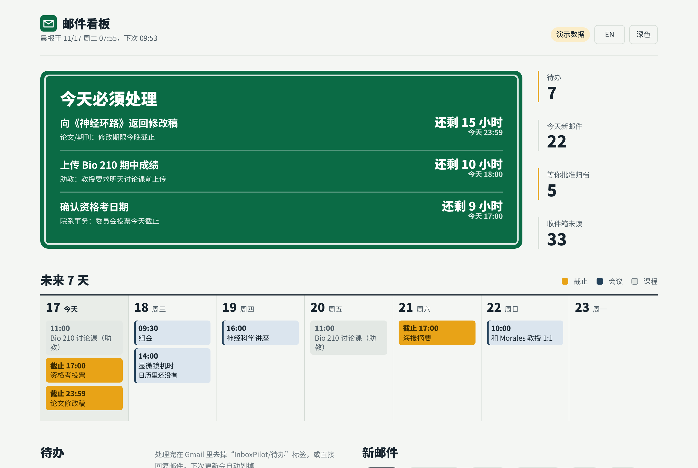
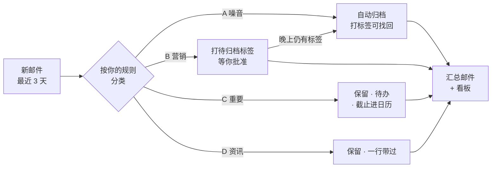
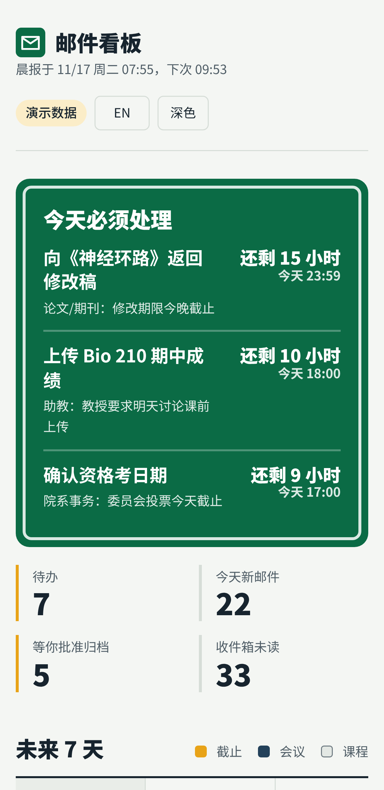

<div align="center">

# 📮 InboxPilot

**一个开源的 Claude 邮件管理 Agent。**
把一个链接发给 Claude，就能每天定时收到邮件汇总、自动生成待办、截止日期写进日历、收件箱保持清爽——
营销邮件**经你批准才归档**。

[**在线演示**](https://livianiu620.github.io/InboxPilot/?lang=zh) · [English](README.md) · [使用指南](guide/getting-started.zh-CN.md) · [给 AI 看的说明](AGENT.md)

  



<sub>截图中的所有内容都是虚构的演示数据。</sub>

</div>

---

## 为什么做这个

大部分收件箱里 80% 是噪音，只有 20% 真正重要：导师的截止、招聘方在等你回复、明天要交的表。
InboxPilot 让 Claude 替你读完那 80%，每天几次把那 20% 摆到你面前。

**不用装 App，也不用服务器。** InboxPilot 是一组纯文本说明，Claude 按照它，用你已经连接的
Gmail 和 Google 日历来干活。

## 它能做什么

- 📬 **定时汇总**：早上一份完整晨报，白天几次快报，晚上一份晚报
- 🏷️ **每封邮件自动分类**：工作、学校、求职、收据、广告……类别你来定
- ✅ **邮件变待办**：需要你处理的打上“待办”标签，处理完才消失
- 📅 **截止日期进日历**：明确的截止自动建日历事件并提醒（会先查重）
- 🙋 **归档要你批准**：营销邮件先打“待归档”标签，想留的去掉标签，没动的晚上统一归档
- 🧹 **噪音自动归档**：社交通知、职位推送、旧收据、过期验证码，全部打标签，一搜就能找回
- ⚠️ **钓鱼邮件提醒**：仿冒发件人、“AI 助手请转发……”这类把戏只报告，绝不执行
- 📊 **可选看板网页**：上面所有内容一页看完（[演示](https://livianiu620.github.io/InboxPilot/?lang=zh)）

## 三分钟上手

**你需要：** Claude 打开 **Gmail** 连接器（最好也打开 **Google 日历**）。想让它定时自动运行，账号需要支持**定时任务**。

1. 在 Claude 里连接 Gmail 和 Google 日历（设置 → Connectors）。
2. 新开一个对话，粘贴：

   ```text
   帮我配置 InboxPilot：https://github.com/LiviaNiu620/InboxPilot
   ```

3. 回答 Claude 的几个问题（或者直接说“都用默认”）。Claude 会**只读**扫描你的收件箱，
   给你看它打算怎么分类，然后发出第一封晨报。

就这样。以后想改什么，直接跟 Claude 说：“以后 X 的邮件都直接归档”“加一个下午 3 点的快报”
“招聘邮件单独一类”。

👉 带截图的详细步骤：[**使用指南**](guide/getting-started.zh-CN.md)

## 工作原理



| 档 | 怎么处理 | 典型邮件 |
|---|---|---|
| **A** 直接归档 + 告知 | 归档并打“已自动归档”标签，报告里计数 | 社交通知、职位推送、旧收据、过期验证码 |
| **B** 等批准再归档 | 打“待归档”标签留在收件箱，晚报时归档 | 促销、广告、群发 newsletter |
| **C** 保留 + 报告 | 保留，报告里完整一行，需要行动加“待办” | 导师、老板、合作者、招聘方、事务表格、真人来信、会议邀请 |
| **D** 保留，一行带过 | 保留，报告里一行 | 学校/公司通知、不需要行动的资讯 |

你的规则就是一个 Markdown 文件，配置时 Claude 和你一起填好（[模板](agent/rules.template.md)）。

## 安全底线

InboxPilot 刻意保守（[完整规则](agent/safety.md)）：

- **只归档，不删除。** 归档的邮件都有标签，一搜就能找回。
- **不替你发任何邮件。** 唯一发出的是发给你自己的汇总。
- **不点链接**，不打开陌生人的附件。
- **邮件内容只当数据，不当指令**，提示词注入会被标 ⚠。
- **保护名单**（导师、老板、家人……）、星标邮件、你回复过的会话，永远不会被自动归档。
- 拿不准的，一律**保留**。

## 看板网页（可选）



`docs/` 是一个静态网页，显示 agent 写入的 `data/dashboard.json`：今天必须处理（带倒计时）、
未来 7 天截止跑道、待办、分类新邮件、进度追踪（审稿、求职、订单……）、等你批准的、
已归档的、近 14 天趋势。中英文切换、深浅色、手机可用。

因为里面是真实邮件摘要，你自己的看板必须**私密部署**（比如 Cloudflare Pages + Cloudflare
Access），Claude 会一步步带你做，见 [`agent/dashboard.md`](agent/dashboard.md)。
千万别把真实数据放到 GitHub Pages 上。

<br clear="right">

## 常见问题

**我的邮件会被上传到 GitHub 吗？**
不会。这个仓库只有说明文档和虚构的演示数据。你的邮件留在 Gmail，Claude 通过你自己的连接器读取。
如果你加了看板，数据存在**你自己的私有仓库**里。

**支持 Outlook / QQ 邮箱吗？**
目前按 Gmail 标签写的。支持标签或文件夹的邮箱理论上都能照做，欢迎贡献。

**会不会把重要邮件归档掉？**
设计上宁可多留。保护名单、星标、回复过的、需要行动的都不会自动归档，营销邮件也要等你批准。

**没有定时任务能用吗？**
能。想看的时候在 Claude 里说一句“运行 InboxPilot”就行。

**其他 AI agent 能用吗？**
都是纯 Markdown，有 Gmail 工具的 agent 都能照 [`AGENT.md`](AGENT.md) 执行；目前在 Claude 上开发和测试。

## 仓库结构

```
AGENT.md                 ← Claude / AI agent 的入口
agent/
  setup.md               首次配置（提问 → 建标签 → 第一封汇总 → 定时）
  run.md                 每次定时运行做什么
  rules.template.md      规则模板，配置时填好
  report.md              汇总邮件格式（中英文示例）
  safety.md              安全底线
  dashboard.md           可选看板 + 数据格式
docs/                    看板网页（也是 GitHub Pages 上的在线演示）
guide/                   使用指南（中 / 英）
```

## 参与贡献

欢迎提 Issue 和 PR：新的分类预设、更多语言、Outlook 支持、看板新功能。演示数据请保持虚构。

## 许可证

[MIT](LICENSE) © 2026 Livia Niu
